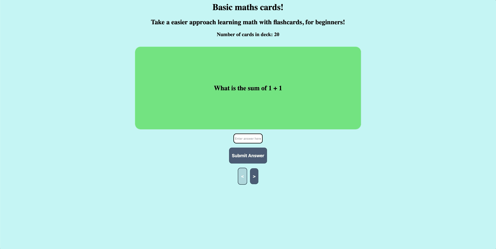

# WEB102 Project 3 🧮

An interactive math flashcard application built using React and Vite. Designed to help beginners practice basic mathematical operations through interactive flashcards, answer validation, and simple navigation.

## 🎥 Demo



## ✨ Features

- **Interactive Flashcards:** View math questions and reveal their answers.
- **Multiple Math Categories:** Practice addition, subtraction, multiplication, and division.
- **Answer Validation:** Submit answers and receive visual feedback based on correctness.
- **Flashcard Navigation:** Move forward and backward through the deck.
- **Dynamic Button States:** Navigation buttons automatically update when reaching the first or last flashcard.
- **Automatic Input Reset:** Clears previous answers when switching between flashcards.
- **Card Counter:** Displays the total number of flashcards available.

## 🛠️ Technologies Used

- **React.js** – Component-based user interface and state management.
- **JavaScript (ES6+)** – Application logic and event handling.
- **HTML5** – Application structure.
- **CSS3** – Styling and visual feedback.
- **Vite** – Development server and build tool.

## 🚀 Getting Started

### Prerequisites

Make sure you have Node.js and npm installed.

### 1. Clone the Repository

```bash
git clone https://github.com/SamM-SWE/WEB102-PROJECT3.git
```

### 2. Navigate to the Project Directory

```bash
cd WEB102-PROJECT3
```

### 3. Install Dependencies

```bash
npm install
```

### 4. Start the Development Server

```bash
npm run dev
```

Open the local URL displayed in your terminal to view the application.

## 📖 How to Use

1. Open the application in your browser.
2. Read the mathematical question displayed on the flashcard.
3. Enter your answer in the input field.
4. Click **Submit Answer** to check your response.
5. Receive visual feedback indicating whether your answer is correct.
6. Use the navigation arrows to move between flashcards.
7. Click a flashcard to reveal its answer.

## 🧠 React Concepts Practiced

This project demonstrates several fundamental React concepts:

- Managing application state using `useState`.
- Passing data between components using props.
- Handling user interactions with event handlers.
- Conditionally applying CSS classes.
- Dynamically rendering content based on state.
- Managing controlled form inputs.
- Implementing conditional navigation logic.

## 📂 Project Structure

```text
WEB102-PROJECT3/
├── public/
├── src/
│   ├── components/
│   │   └── Card.jsx
│   ├── App.jsx
│   ├── App.css
│   └── ...
├── index.html
├── package.json
├── vite.config.js
├── WEB102-PROJECT3-GIF.gif
└── README.md
```

## 👨‍💻 Author

**Samuel Monneh**

GitHub: [@SamM-SWE](https://github.com/SamM-SWE)
